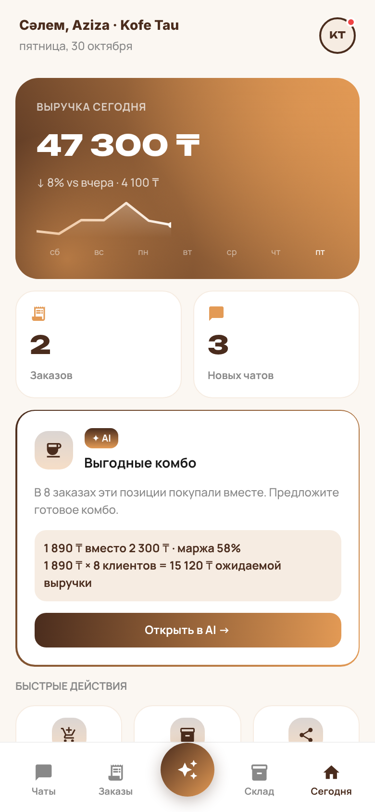
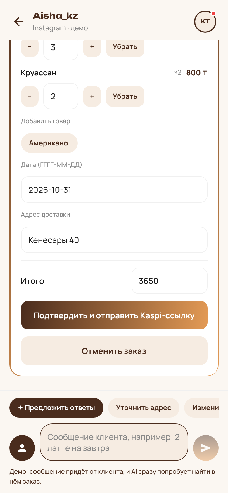
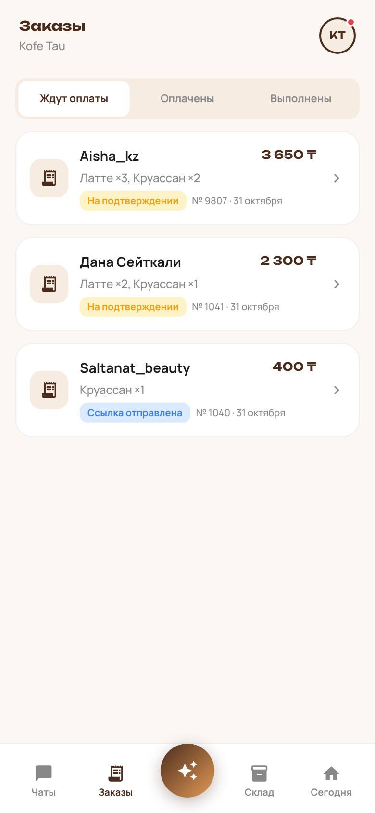
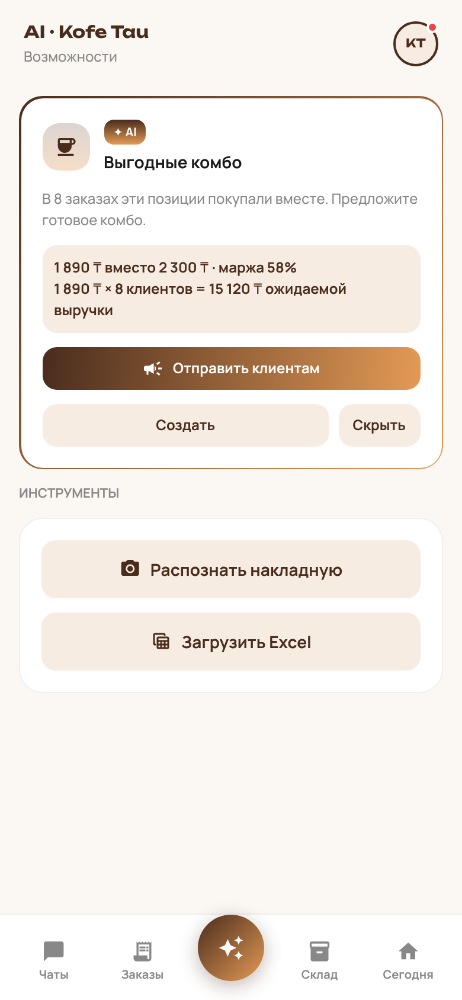

# OrderIN — MVP

**AI-помощник для микро-продавцов Казахстана: заказы из чатов → Kaspi-оплата → умный склад.**

### ▶ [Open the live MVP — zere90.github.io/OrderIN](https://zere90.github.io/OrderIN/)

Works in any browser, no installation. Demo login: any 10-digit phone, code **1234**. Best viewed at phone size (on a laptop: DevTools → device toolbar).

OrderIN is a mobile-first app (Expo / React Native, also runs in the browser) for small sellers who take orders in Instagram and WhatsApp DMs — coffee shops, home bakeries, clothing brands, beauty studios, small groceries. The interface is in Russian; customer messages can be in Russian, Kazakh or English.

## The problem and the MVP hypothesis

A micro-seller reads every DM by hand, retypes the order, sends a Kaspi payment link, and then has to remember to update stock. Orders get lost, stock goes out of sync, and there is no time left to win back regular customers.

**Hypothesis tested by this MVP:** if a seller sees an incoming chat message turned automatically into an editable order — and payment then updates stock by itself — they will process orders faster and with fewer mistakes, and will want to use the product every day.

The MVP is a *working product with mocked external services*: chat parsing, order lifecycle, stock deduction, opportunities and imports really run; Instagram/WhatsApp, Kaspi and SMS are simulated in demo mode and clearly labelled «демо». See [docs/MVP.md](docs/MVP.md) for the user path, feature priorities and the testing plan, and [docs/MVP_REPORT.md](docs/MVP_REPORT.md) for the list of fixes and the verification performed.

## Main user journey (walking skeleton)

1. **Onboarding** — demo phone login (any 10 digits, code **1234**) → choose business type → two questions → connect channels (demo) → load products.
2. **Чаты** — a customer message arrives; AI detects an order (products, quantity, date, address) and shows an editable order card.
3. **Confirm** — «Подтвердить и отправить Kaspi-ссылку» validates the order against stock and sends a (demo) payment link into the chat.
4. **Payment** — «Симулировать оплату» marks it paid and **deducts stock exactly once** (including recipe ingredients for food businesses).
5. **Заказы / Склад / Сегодня** — the order moves through *awaiting → paid → completed*, stock and history update, and today's revenue grows.

To show the AI live during a presentation: open any chat, tap the **person icon** next to the input («Написать от имени клиента (демо)»), type e.g. `Закажу 3 латте и 2 круассана на завтра. Адрес: Кенесары 40`, and send — the order card appears immediately.

## MVP features

| Area | What works |
|---|---|
| Onboarding | Demo login with validation, 6 business types, questions, demo channel toggles, product upload step |
| Chats | Inbox with Instagram/WhatsApp/orders/questions filters, unread badges, AI message classification (order / question / feedback) with confidence, live parsing of new customer messages (ru/kk/en), AI reply suggestions + quick replies, seller replies |
| Orders | Editable AI order card (items, quantity, date, address, total), validation (positive integers, valid dates, stock shortage), Kaspi link (demo), payment simulation, completion, cancellation before payment, timeline, manual «Новый заказ» (choose customer + product), order numbers |
| Stock | Per-business catalog (variants, ingredients, materials), search & filters, low-stock warnings, manual ± edits, add product, Excel/CSV import with column mapping and diff preview, invoice-photo recognition (demo sample works without camera), full change history with sources |
| AI opportunities | Computed from each business's own data: combos, outfits, last sizes, repeat baskets, expiry, free slots, service packages, pre-orders, celebrations, shopping list — with outreach preview, recipient selection, create/hide/undo |
| Today | Revenue for today with 7-day sparkline, order/new-chat counters, top opportunity, quick actions |
| Multi-business | 3 businesses by default, add more (6 types / skins), isolated data per business, business switcher with revenue and unread |
| Settings | Light / dark / system theme, all six skins preview, demo reset |
| Clothing | Size try-on demo → recommended size → draft order for the available variant |
| Persistence | All data saved on the device (AsyncStorage / localStorage) and restored after reload |

**Demo vs. real:** payments (Kaspi), SMS login, message delivery to Instagram/WhatsApp and the invoice OCR sample are simulated and marked «демо» in the UI. AI parsing works locally without a server; with Supabase configured it uses a real LLM and falls back to the local parser on any error.

## Technologies

- **Expo SDK 57**, React Native 0.86, React 19, TypeScript (strict)
- **Expo Router** (file-based navigation), **Zustand** + AsyncStorage (state & persistence)
- expo-linear-gradient, react-native-svg, expo-haptics, expo-image-picker, expo-document-picker, expo-image-manipulator
- **SheetJS (xlsx 0.20.3)** for Excel/CSV import
- Fonts: Unbounded (display) + Manrope (body), Material icons
- Optional backend: **Supabase** (Auth, Postgres, Realtime, Deno Edge Functions) with Gemini or Anthropic models — see [docs/INTEGRATIONS.md](docs/INTEGRATIONS.md)

## Installation

Requirements: **Node.js 20.19.4+** (22 LTS recommended) and npm. For a phone: the **Expo Go** app compatible with SDK 57.

```sh
npm install
```

> `xlsx` is installed from the official SheetJS CDN (`cdn.sheetjs.com`), as SheetJS recommends. The computer needs internet access to that host during `npm install`.

## Running the project

| Goal | Command |
|---|---|
| Phone (Expo Go) | `npx expo start` → scan the QR code. Different network: `npx expo start --tunnel` |
| Browser (development) | `npm run web` |
| Production web build | `npm run build:web` → creates `dist/` |
| Serve the production build | `npm run serve:web` → open http://localhost:8080 (any page can be reloaded) |
| Build check for web + iOS + Android bundles | `npm run build:all` |

For a presentation in a browser, open the app in phone size (DevTools → device toolbar, e.g. 390×844). On wide screens the app is shown as a centred column.

**Before a live demo:** Профиль и настройки → «Сбросить демо-данные». Demo data is generated relative to the current date; resetting refreshes today's revenue, tomorrow's orders and the chat history. Onboarding is not repeated after reset.

## Publishing on GitHub Pages

The live link above is built automatically by [`.github/workflows/deploy-pages.yml`](.github/workflows/deploy-pages.yml): on every push to `main` GitHub installs dependencies, runs the tests and type check, exports the web app for the `/OrderIN/` path and publishes it. The published build runs in demo mode (no `.env`, no secrets).

One-time setup in the repository: **Settings → Pages → Build and deployment → Source: “GitHub Actions”**. Progress is visible in the **Actions** tab; the first deployment takes about 3–5 minutes.

To reproduce the Pages build locally: `EXPO_BASE_URL=/OrderIN EXPO_WEB_OUTPUT=single npx expo export --platform web` (configuration in `app.config.js`).

## Environment configuration

No configuration is required — **without `.env` the app runs fully in demo mode**.

Optional (live AI + real Instagram/WhatsApp chats):

```sh
cp .env.example .env
# EXPO_PUBLIC_SUPABASE_URL=https://YOUR_PROJECT_REF.supabase.co
# EXPO_PUBLIC_SUPABASE_ANON_KEY=YOUR_PUBLIC_ANON_KEY
npx expo start --clear   # --clear is required after changing .env
```

Only the public URL and anon key go into the app. AI provider keys, Meta secrets and the service-role key are set as Supabase secrets on the server — never in `.env`. `.env` is ignored by Git. Server setup (migrations, Edge Functions, Meta app, webhooks) is described in [docs/INTEGRATIONS.md](docs/INTEGRATIONS.md).

With Supabase configured, demo chats keep working exactly the same; real conversations appear under «Чаты → Подключённые каналы». If the server is unreachable, the app shows «AI недоступен. Показан демо-результат.» with a retry button instead of failing.

## Testing

```sh
npm test            # domain, AI-service and messaging regression suites
npm run typecheck   # strict TypeScript
npm run build:all   # web + iOS + Android bundles
```

`npm test` covers business isolation, opportunity maths, the ru/kk/en parser, order/payment transitions (including double taps and reset races), stock deduction, pre-order deposits, shopping lists, Excel/CSV mapping and validation, persistence, and the MVP journey *customer message → AI order → payment → stock*. Optional server tests: `npm run test:edge`, `npm run test:meta` (need Deno), SQL tests need Docker (see integrations doc).

## Project structure

```text
app/                      screens (Expo Router)
  (tabs)/                 Чаты, Заказы, AI, Склад, Сегодня
  chat/[id].tsx           conversation, AI order card, demo customer messages
  order/[id].tsx          order details and timeline
  import.tsx              invoice photo, Excel/CSV and manual stock import
  onboarding.tsx          first launch / add business
  settings.tsx, skins.tsx theme, reset, skin previews
  tryon/, shopping/       size try-on, ingredient shopping list
src/
  components/             shared UI (Screen, Card, Button, BottomSheet, OrderCard, …)
  data/                   six business catalogs and demo seed
  i18n/ru.ts              all Russian UI strings and formatting
  services/               AI, messaging, payments, opportunities, imports, inventory
  store/                  persisted Zustand store and order/stock transactions
  theme/                  six skins, tokens, fonts, light/dark theme
supabase/                 optional backend: migrations and Edge Functions
scripts/serve-web.cjs     zero-dependency server for the web build
.github/workflows/        GitHub Pages deployment
tests/                    regression suites
docs/                     MVP scope, integrations, screenshots
design/figma-make/        read-only design reference (not built)
```

## Known limitations

- Kaspi payments, SMS login and delivery of demo messages are simulated; real Instagram/WhatsApp require the Supabase + Meta setup and Meta App Review for third-party sellers.
- Without the server, AI uses a local rule-based parser: it recognises catalogue items, quantities (digits and number words in ru/kk/en), «завтра/сегодня» and «Адрес: …», but not arbitrary free-form requests. The invoice-photo demo returns sample rows and does not read the photo.
- Data lives only on the device (no user accounts or cloud sync in demo mode); clearing browser/app storage starts over.
- Demo history is dated relative to the day it was generated — reset before presenting on another day.
- The size recommendation is a deterministic demo, not a measurement.
- Unbounded/Manrope fonts lack some Kazakh letters, so text containing them is shown in the system font.
- Camera, file pickers and haptics were verified only in the browser build here; final checks on a physical phone in Expo Go are recommended.

## Screenshots

| Today | AI order in chat | Orders | AI opportunities |
|---|---|---|---|
|  |  |  |  |

License: see [LICENSE](LICENSE).
